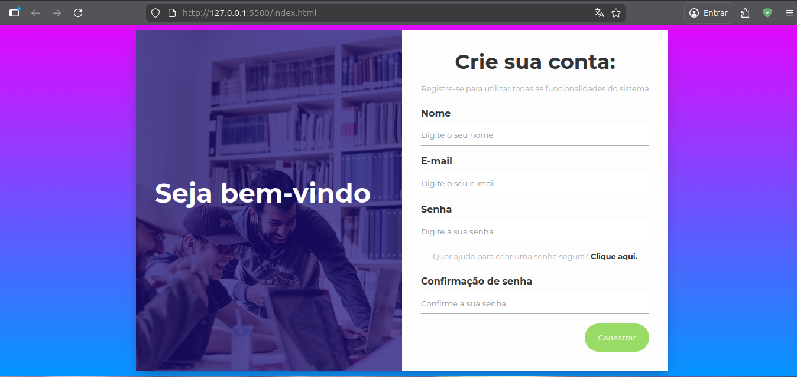
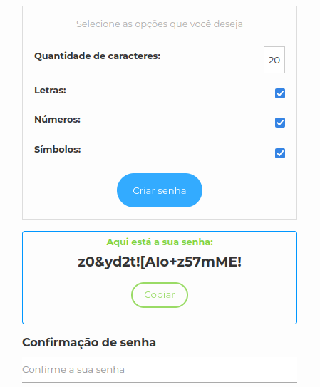

# Password Generator

A simple and efficient password generator built with web technologies. This project allows users to generate secure passwords with custom lengths and character types (uppercase, lowercase, numbers, and symbols).

## Technologies Used

This project was developed using the following technologies:

- **HTML5**: For structure and semantic content.
- **CSS3**: For styling and responsive design.
- **JavaScript (ES6+)**: For logic and password generation functionality.

## Project Structure

Below is the directory structure of the project (excluding development folders):

```text
.
├── assets
│   ├── css
│   │   └── styles.css
│   ├── img
│   └── js
│       └── scripts.js
├── index.html
└── README.md
```

## How to Run the Project

You can run this project locally in two ways:

### 1. Using Live Server (Recommended)

This method automatically refreshes the page as you make changes to the code.

1. Open the project folder in **Visual Studio Code**.
2. Install the **Live Server** extension (by Ritwick Dey).
3. Right-click on `index.html` in the explorer.
4. Select **"Open with Live Server"**.

### 2. Without Live Server

You can also run it directly in any modern web browser.

1. Navigate to the project folder on your computer.
2. Locate the `index.html` file.
3. Double-click the file or right-click and select **"Open with..."** and choose your preferred browser.

## Project Previews



